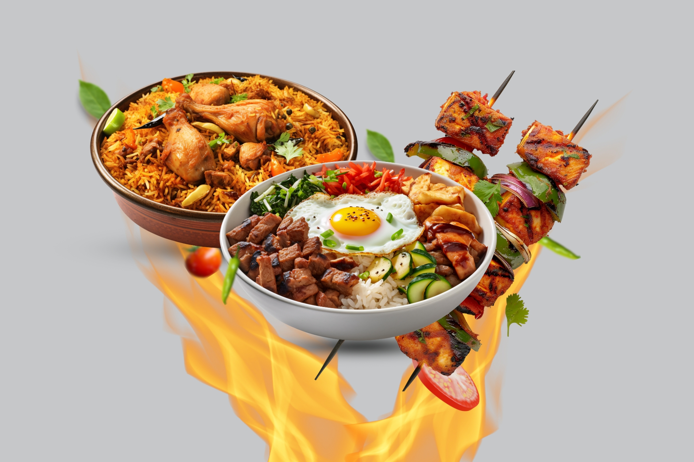
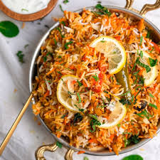
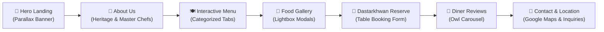
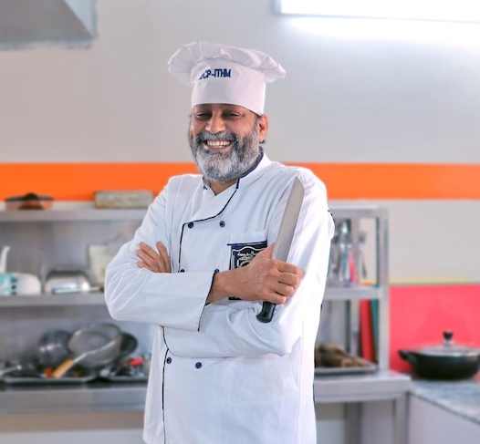
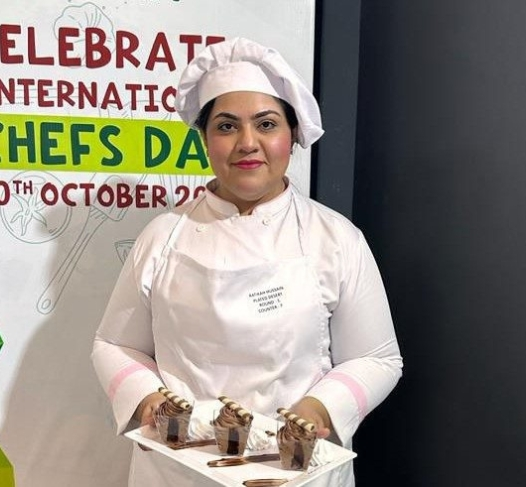

<div align="center">

<!-- PROJECT BANNER / LOGO -->


<br><br>

# ⚜️ H A M S A ⚜️
### 🍛 حمسہ — جہاں ذائقہ اور روایت کا حسین سنگم ہو 🍛
***“Har bite mein desi khushboo aur rangon ka jahan.”***

<p align="center">
  <b>A modern, immersive, and responsive digital culinary showcase for traditional Pakistani & South Asian fine dining.</b>
</p>

<!-- BADGES SECTION -->
<p align="center">
  <a href="#-live-sections-preview"></a>
  <a href="https://developer.mozilla.org/en-US/docs/Web/HTML"></a>
  <a href="https://developer.mozilla.org/en-US/docs/Web/CSS"></a>
  <a href="https://developer.mozilla.org/en-US/docs/Web/JavaScript"></a>
  <a href="https://getbootstrap.com/"></a>
  <br>
  
  
  
  
</p>

<!-- QUICK NAVIGATION PILLS -->
<p align="center">
  <a href="#-project-highlights">🌟 Highlights</a> •
  <a href="#-visual-culinary-gallery">📸 Food Showcase</a> •
  <a href="#-user-experience-flow">🗺️ User Journey</a> •
  <a href="#-directory-structure">📁 Directory Tree</a> •
  <a href="#-tech-stack--libraries">🛠️ Tech Stack</a> •
  <a href="#-quick-start">🚀 Quick Start</a> •
  <a href="#-customization-guide">🎨 Customization</a>
</p>

---

</div>

<br>

## 🌟 Project Highlights

> [!NOTE]
> **Hamsa** is engineered to bring centuries of subcontinental culinary heritage into the digital age. Built with passion and attention to detail, it combines royal Eastern aesthetic elements with cutting-edge front-end responsiveness.

<table>
  <tr>
    <td width="50%" valign="top">
      <h3>🏺 Heritage Meets Modernity</h3>
      <ul>
        <li><b>Royal Desi Typography:</b> Editorial design using <i>Playfair Display</i> paired with crisp <i>Open Sans</i> readability.</li>
        <li><b>Warm Cultural Palette:</b> Rich saffron, terracotta accents, charcoal contrasts, and warm ivory backgrounds.</li>
        <li><b>Seamless Cross-Device UX:</b> Tailored breakpoints for mobile smartphones, tablets, laptops, and 4K displays.</li>
      </ul>
    </td>
    <td width="50%" valign="top">
      <h3>⚡ Dynamic Interactivity</h3>
      <ul>
        <li><b>Smooth Parallax:</b> Background depth illusion powered by <i>Stellar.js</i>.</li>
        <li><b>On-Scroll Reveals:</b> Staggered animations using <i>AOS (Animate on Scroll)</i>.</li>
        <li><b>Magnific Popup Lightbox:</b> Fullscreen zoomable food gallery modals.</li>
        <li><b>Owl Carousel Testimonials:</b> Touch-enabled swipeable review slider.</li>
      </ul>
    </td>
  </tr>
</table>

---

## 📸 Visual Culinary Gallery

Experience the authentic culinary journey showcased in Hamsa:

| 👑 **Biryani & Rice** | 🍲 **Signature Karahi** | 🧈 **Butter Chicken** |
|:---:|:---:|:---:|
|  |  |  |
| *Dum Pukht Zafrani Biryani* | *Desi Ghee Shinwari Karahi* | *Velvety Murgh Makhani* |

| 🥞 **Traditional Halwa Puri** | 🍢 **Peshawari Chapli Kebab** | ☕ **Karak Chai & Samosa** |
|:---:|:---:|:---:|
|  |  |  |
| *Crisp Puris & Suji Halwa* | *Charcoal Grilled Kebabs* | *Dhaba Style Chai & Samosa* |

---

## 🗺️ User Experience Flow



---

## 📑 Live Sections Preview

<details open>
<summary><b>🔍 Explore All Sections Included (Click to Collapse/Expand)</b></summary>
<br>

| # | Section | Identifier | Purpose & Content |
|---|---|---|---|
| **01** | **Hero Showcase** | `#section-home` | Parallax background with Urdu tagline, branding, and quick CTA reservation button. |
| **02** | **About Story** | `#section-about` | Restaurant background, authentic culinary philosophy, and master chef credentials. |
| **03** | **Interactive Gallery** | `#section-gallery` | Visual feast of dishes and restaurant ambience with popup preview support. |
| **04** | **Royal Menu** | `#section-menu` | Tabbed menu: *Sabziyan*, *Gosht*, *Murgh*, *Chawal & Kebabs*, and *Nashta*. |
| **05** | **Dastarkhwan Reserve** | `#section-reservation` | Booking system for dates, times, party size, and special requests. |
| **06** | **Customer Reviews** | `#section-testimonials` | Dynamic client feedback carousel sharing experiences and ratings. |
| **07** | **Find & Contact Us** | `#section-contact` | Embedded Google Maps location, contact numbers, email, and inquiry form. |
| **08** | **Footer & Newsletter** | `footer` | Social links, newsletter subscription, and copyright information. |

</details>

---

## 📁 Directory Structure

The project follows a clean, professional asset-isolated structure:

```text
📦 Hamsa
 ┣ 📂 assets
 ┃ ┣ 📂 css
 ┃ ┃ ┣ 📜 animate.css             # Pre-built CSS animation keyframes
 ┃ ┃ ┣ 📜 aos.css                 # Animate On Scroll core styles
 ┃ ┃ ┣ 📜 bootstrap.css           # Bootstrap 4 responsive grid & utility system
 ┃ ┃ ┣ 📜 magnific-popup.css      # Modal lightbox overlay stylesheet
 ┃ ┃ ┣ 📜 owl.carousel.min.css    # Touch carousel styling
 ┃ ┃ ┗ 📜 style.css               # Core custom theme & fine dining styles
 ┃ ┣ 📂 js
 ┃ ┃ ┣ 📜 aos.js                  # Scroll animations engine
 ┃ ┃ ┣ 📜 bootstrap.min.js        # Bootstrap components & dropdowns
 ┃ ┃ ┣ 📜 jquery-3.2.1.min.js     # Fast DOM manipulation core
 ┃ ┃ ┣ 📜 jquery-migrate-3.0.1.min.js
 ┃ ┃ ┣ 📜 jquery.easing.1.3.js    # Smooth easing curve transitions
 ┃ ┃ ┣ 📜 jquery.stellar.min.js   # Parallax scrolling script
 ┃ ┃ ┣ 📜 jquery.waypoints.min.js # Viewport scroll triggers
 ┃ ┃ ┣ 📜 owl.carousel.min.js     # Touch-friendly carousel slider
 ┃ ┃ ┣ 📜 popper.min.js           # Tooltip & popover engine
 ┃ ┃ ┗ 📜 main.js                 # Custom project initialization & handlers
 ┃ ┣ 📂 images                    # All high-res food items, banners, team & icons
 ┃ ┗ 📂 fonts                     # Icon font libraries (flaticon, fontawesome, ionicons)
 ┣ 📜 .gitignore                  # Git repository exclusion file
 ┣ 📜 index.html                  # Single-page application entry point
 ┣ 📜 LICENSE                     # MIT Open Source License
 ┗ 📜 README.md                   # Comprehensive project documentation
```

---

## 🛠️ Tech Stack & Libraries

<div align="center">

| Component | Technology | Version | Purpose |
|:---|:---|:---|:---|
| **Markup** | HTML5 | Semantic Standard | Accessible structure, SEO optimization & meta tags |
| **Styles** | CSS3 | Modern Standard | Custom styling, CSS Grid, Flexbox & theme typography |
| **Framework** | Bootstrap | `v4.x` | Responsive grid, containers & utility classes |
| **Scripting** | JavaScript | ES6+ | Dynamic behaviors, DOM manipulation & form handlers |
| **DOM Engine** | jQuery | `v3.2.1` | Efficient DOM querying and plugin lifecycle hooks |
| **Scroll Animation** | AOS | `v2.x` | Trigger entrance animations during scroll |
| **Slider Engine** | Owl Carousel | `v2.x` | Responsive, touch-enabled customer review slider |
| **Lightbox** | Magnific Popup | `v1.x` | High-definition popup modal image viewer |
| **Parallax** | Stellar.js | `v0.6.2` | Parallax scrolling effects for hero & banners |
| **Mapping** | Google Maps API | `v3` | Interactive restaurant location pin and map |

</div>

---

## 🚀 Quick Start

Getting Hamsa running on your local machine is effortless:

### 1️⃣ Clone the Repository
```bash
git clone https://github.com/your-username/Hamsa.git
cd Hamsa
```

### 2️⃣ Launch in Browser

#### ⚡ Option A: VS Code Live Server *(Recommended)*
1. Open the project in **VS Code**: `code .`
2. Install the **Live Server** extension.
3. Right-click on `index.html` and select **"Open with Live Server"**.

#### 🐍 Option B: Python HTTP Server
```bash
# Start local server on port 8000
python -m http.server 8000
```
Open [http://localhost:8000](http://localhost:8000) in your browser.

#### 📦 Option C: Node `npx serve`
```bash
npx serve .
```

#### 🌐 Option D: Direct File Access
Simply double-click `index.html` to open it in your default web browser.

---

## 🎨 Customization Guide

### 🏷️ Updating Menu Items
All menu items are cleanly formatted in [index.html](index.html#section-menu). To add or edit a dish:

```html
<div class="col-md-6 mb-4">
  <div class="ftco-46-text d-flex align-items-center">
    <div class="menu-img mr-3">
      <!-- Add your dish image to assets/images/ -->
      
    </div>
    <div class="text">
      <div class="d-flex">
        <div class="one-half">
          <h3>Dish Name</h3>
        </div>
        <div class="one-forth text-right">
          <span class="price">Rs. 1,450</span>
        </div>
      </div>
      <p>Rich and flavorful description of your special delicacy.</p>
    </div>
  </div>
</div>
```

### 🎨 Color Palette Reference
Easily customize theme highlights in `assets/css/style.css`:
- 🟠 **Primary Accent:** `#ff7a5c` *(warm saffron terracotta)*
- ⚫ **Deep Charcoal:** `#1d1f21` / `#222222`
- ⚪ **Background Soft Light:** `#f8f9fa`

### 🗺️ Google Maps Integration
To show your restaurant's exact location, update your API key in `index.html`:
```html
<script src="https://maps.googleapis.com/maps/api/js?key=YOUR_API_KEY_HERE&sensor=false"></script>
```

---

## 🌐 Browser Support

<div align="center">

| Chrome | Firefox | Safari | Edge | Opera |
|:---:|:---:|:---:|:---:|:---:|
| <br>Latest | <br>Latest | <br>Latest | <br>Latest | <br>Latest |

</div>

---

## 👨‍🍳 Team & Culinary Masters

<div align="center">
  <table>
    <tr>
      <td align="center">
        <br>
        <b>Chef Usman Ali</b><br>
        <sub>Master of Royal Karahi & Dum Pukht</sub>
      </td>
      <td align="center">
        <br>
        <b>Chef Rabia Shah</b><br>
        <sub>Artisanal Desserts & Traditional Breads</sub>
      </td>
    </tr>
  </table>
</div>

---

## 👨‍💻 Author & Credits

<div align="center">

Crafted with dedication by **[M Hammad](https://github.com/)**  
*Front-End Developer at Hamsa*

[](https://github.com/)
[](index.html)

<br>

*Special thanks to the open-source community behind Bootstrap, jQuery, AOS, Owl Carousel, and Magnific Popup.*

</div>

---

<div align="center">

### 📜 License
This project is open-source and released under the **[MIT License](LICENSE)**.

<sub>🌟 If you love this project, don't forget to give it a star on GitHub! 🌟</sub>

<br>

**حمسہ — ہر نوالے میں ذائقہ، ہر لمحے میں روایت**  
*Hamsa — Taste in every bite, tradition in every moment.*

</div>
